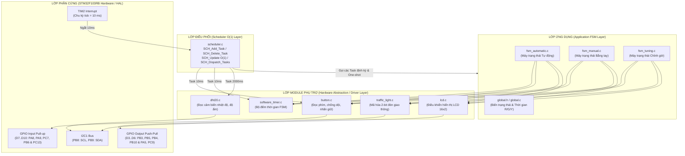
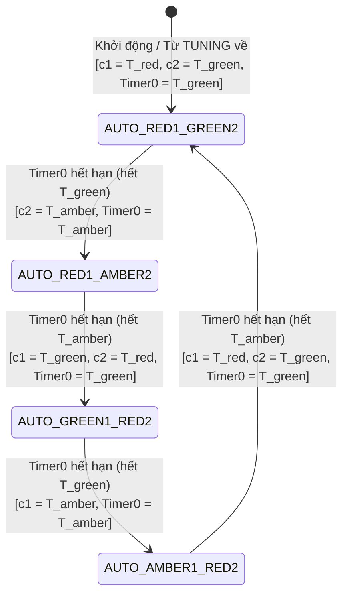
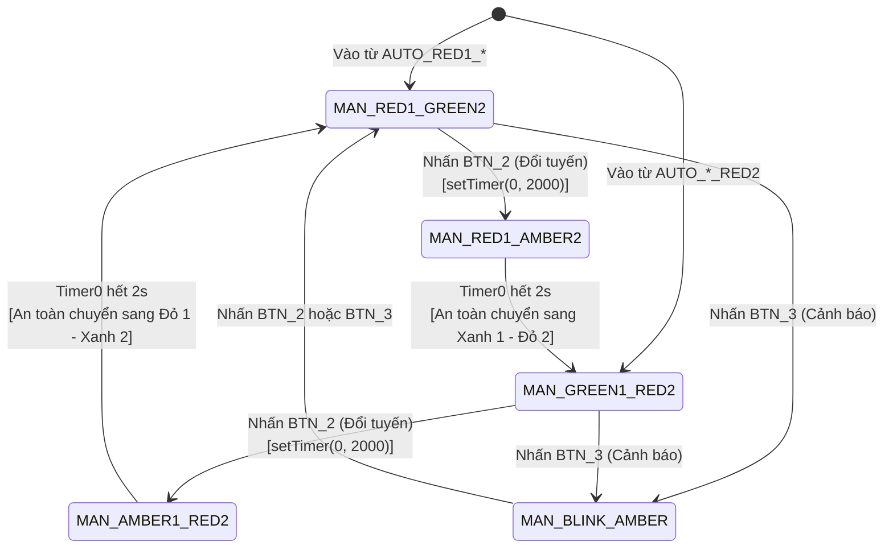

# Thiết Kế Hệ Thống Đèn Giao Thông 2 Tuyến Đường (BTL CO3009)

Tài liệu này được trình bày bám sát từng mục trong mẫu báo cáo **`Mau_BaoCao_BTL_CO3009.docx`**, giúp bạn vừa nắm rõ nguyên lý hoạt động để kiểm soát mạch khi chạy thực tế, vừa có thể copy trực tiếp vào file Word báo cáo.

---

## 1. Giới thiệu dự án

### 1.1 Tổng quan
Hệ thống điều khiển đèn giao thông cho ngã tư 2 tuyến đường vuông góc (Tuyến 1 và Tuyến 2) được phát triển trên bo mạch **XNUCLEO-F103RB** (vi điều khiển **STM32F103RBT6**, lõi ARM Cortex-M3, tần số hoạt động 64 MHz) kết hợp với mạch mở rộng **Grove Shield**.

Hệ thống sử dụng các thiết bị ngoại vi:
- **02 Module đèn giao thông (ACLAB_HCMUT Traffic Light)**: mỗi module gồm 3 đèn Đỏ – Vàng – Xanh được mã hóa điều khiển qua 2 chân tín hiệu số (`A, B`), kết nối tại khe **D3–D4** (Tuyến 1) và **D5–D6** (Tuyến 2).
- **02 Module nút nhấn đôi**: cung cấp 4 nút nhấn độc lập tại khe **D7–D8** (`BTN_1`, `BTN_2`) và **D9–D10** (`BTN_3`, `BTN_4`), cùng 1 nút nhấn `USER` (`PC13`) và 2 đèn LED báo trạng thái (`PA5`, `PC9`) tích hợp sẵn trên bo mạch.
- **01 Cảm biến nhiệt độ – độ ẩm DHT20** và **01 Màn hình LCD 16x2 I2C**: kết nối chung trên bus **I2C1** (`PB8 - SCL`, `PB9 - SDA`) qua các khe Grove I2C màu đỏ.

**Mục tiêu của dự án:**
Xây dựng một hệ thống nhúng thời gian thực không sử dụng hàm trễ chặn (`HAL_Delay`), vận hành hoàn toàn trên **bộ lập lịch hợp tác (Cooperative Scheduler) có độ phức tạp cập nhật $O(1)$** và kiến trúc phân lớp rõ ràng (Hardware $\rightarrow$ Driver $\rightarrow$ Scheduler $\rightarrow$ FSM Application), đảm bảo chuyển đổi mượt mà và tuyệt đối an toàn giữa 3 chế độ: **Tự động (Automatic)**, **Bằng tay (Manual)** và **Chỉnh thời gian (Tuning)**.

---

### 1.2 Các chức năng của hệ thống

| STT | Chức năng | Mô tả chi tiết | Thao tác / Nút nhấn |
| :-: | :--- | :--- | :--- |
| **1** | **Chế độ tự động (`AUTOMATIC`)** | Hai tuyến đường hoạt động luân phiên theo 4 pha chuẩn: `(Đỏ 1 – Xanh 2)` $\rightarrow$ `(Đỏ 1 – Vàng 2)` $\rightarrow$ `(Xanh 1 – Đỏ 2)` $\rightarrow$ `(Vàng 1 – Đỏ 2)`. Thời gian mặc định ban đầu: **Đỏ = 5s, Xanh = 3s, Vàng = 2s**. Màn hình LCD dòng 1 hiển thị trạng thái đèn và số giây đếm ngược của từng tuyến (`A D1:05s X2:03s`). | Tự động chạy sau khi cấp nguồn/reset, hoặc chuyển về từ chế độ Chỉnh thời gian khi nhấn `BTN_1`. |
| **2** | **Chế độ bằng tay (`MANUAL`)** | Cho phép người điều khiển chủ động chuyển luồng giao thông ưu tiên giữa Tuyến 1 (`Đỏ 1 – Xanh 2`) và Tuyến 2 (`Xanh 1 – Đỏ 2`). Khi bấm đổi chiều, hệ thống **tự động chèn pha đèn Vàng cảnh báo 2 giây** trên tuyến đang Xanh trước khi chuyển sang Đỏ để đảm bảo an toàn giao thông. | - Nhấn `BTN_1`: Vào chế độ Bằng tay từ Tự động.<br>- Nhấn `BTN_2`: Đổi tuyến ưu tiên (có pha Vàng đệm 2s). |
| **3** | **Chế độ chỉnh thời gian (`TUNING`)** | Cho phép thay đổi thời gian của 3 màu đèn (**Đỏ, Vàng, Xanh**) trong khoảng `1..99 giây`. Trong khi chỉnh, đèn giao thông chớp tắt màu đèn đang được chọn với tần số 2 Hz để trực quan hóa; LCD hiển thị thông số đang chỉnh và bộ 3 giá trị `D - X - V`. Tự động kiểm tra ràng buộc $T_{\text{Đỏ}} = T_{\text{Xanh}} + T_{\text{Vàng}}$. | - Nhấn `BTN_1`: Chuyển từ `MANUAL` sang `TUNING`, hoặc lưu & thoát về `AUTOMATIC`.<br>- Nhấn `BTN_2`: Chọn đèn cần chỉnh (`Đỏ` $\rightarrow$ `Vàng` $\rightarrow$ `Xanh`).<br>- Nhấn `BTN_3`: Tăng `+1s` (nhấn giữ tăng nhanh).<br>- Nhấn `BTN_4`: Giảm `-1s`. |
| **4** | **Hiển thị môi trường (DHT20 & LCD)** | Định kỳ mỗi **2 giây** đọc cảm biến DHT20 qua giao tiếp I2C, tính toán nhiệt độ ($^\circ\text{C}$) và độ ẩm tương đối ($\text{\%RH}$), cập nhật lên dòng 2 của LCD (`T:28.5C H:65.0%`). | Tự động cập nhật định kỳ bởi một task độc lập trên Scheduler. |
| **5** | **Chức năng mở rộng: Chế độ Cảnh báo nhấp nháy Vàng & Khôi phục mặc định** | - Trong chế độ Bằng tay, hỗ trợ bật chế độ **Nhấp nháy đèn Vàng cả 2 tuyến (1 Hz)** dùng cho ban đêm hoặc khi ngã tư có sự cố.<br>- Nhấn giữ nút `USER (PC13)` để khôi phục nhanh thời gian mặc định (`Đỏ 5s, Xanh 3s, Vàng 2s`) và dùng **One-shot Task** hiển thị thông báo xác nhận trên LCD trong 1.5 giây. | - Nhấn `BTN_3` trong `MANUAL`: Bật/tắt nhấp nháy Vàng 2 tuyến.<br>- Nhấn `USER (PC13)`: Reset về cấu hình gốc. |

---

### 1.3 Sơ đồ khối hệ thống

Hệ thống được thiết kế phân tầng nghiêm ngặt gồm 4 lớp từ dưới lên: **Lớp Phần cứng (Hardware Layer)** $\rightarrow$ **Lớp Driver Phụ trợ (HAL Wrapper / Driver Layer)** $\rightarrow$ **Lớp Lập lịch (Scheduler $O(1)$ Layer)** $\rightarrow$ **Lớp Ứng dụng Máy trạng thái (Application FSM Layer)**. Các file máy trạng thái (`fsm_*.c`) hoàn toàn độc lập với phần cứng và tuyệt đối không gọi trực tiếp hàm `HAL_*`.



---

## 2. Thiết kế dự án

### 2.1 Tổng quan các chế độ hoạt động

- **Trạng thái khởi động sau khi cấp nguồn / Reset (`INIT`):**
  1. Khởi tạo các ngoại vi (`GPIO`, `I2C1`, `TIM2` chu kỳ ngắt 10 ms) và khởi tạo `SCH_Init()`.
  2. Khởi tạo thời gian mặc định hợp lệ: `time_red = 5` (giây), `time_green = 3` (giây), `time_amber = 2` (giây) — thỏa mãn $T_{\text{Đỏ}} = T_{\text{Xanh}} + T_{\text{Vàng}} = 3 + 2 = 5\text{ s}$.
  3. Khởi tạo màn hình LCD, đọc giá trị DHT20 lần đầu, sau đó tự động chuyển vào pha đầu tiên của **Chế độ Tự động (`AUTO_RED1_GREEN2`)**: Tuyến 1 sáng đèn **Đỏ** (đếm ngược từ 5s), Tuyến 2 sáng đèn **Xanh** (đếm ngược từ 3s).

#### Bảng phân công chức năng của từng nút nhấn trong 3 chế độ

| Nút nhấn | Chân kết nối | Chế độ Tự động (`AUTOMATIC`) | Chế độ Bằng tay (`MANUAL`) | Chế độ Chỉnh thời gian (`TUNING`) |
| :--- | :---: | :--- | :--- | :--- |
| **Nút 1 (`BTN_1`)**<br>*(Ký hiệu `F1`)* | **D7 (`PA8`)** | Chuyển sang **Chế độ Bằng tay (`MANUAL`)**. | Chuyển sang **Chế độ Chỉnh thời gian (`TUNING`)**. | Kiểm tra tính hợp lệ, lưu cấu hình thời gian mới và quay về **Chế độ Tự động (`AUTOMATIC`)**. |
| **Nút 2 (`BTN_2`)**<br>*(Ký hiệu `5`)* | **D8 (`PA9`)** | Làm mới màn hình LCD / Xem chi tiết thông số cài đặt `R-G-Y`. | **Đổi tuyến đường ưu tiên** (`Đỏ 1 – Xanh 2` $\leftrightarrow$ `Xanh 1 – Đỏ 2`) thông qua pha đèn Vàng đệm an toàn 2 giây. | **Chuyển mục đèn cần chỉnh** theo vòng tròn: `Chỉnh Đỏ (RED)` $\rightarrow$ `Chỉnh Vàng (AMBER)` $\rightarrow$ `Chỉnh Xanh (GREEN)`. |
| **Nút 3 (`BTN_3`)**<br>*(Ký hiệu `N`)* | **D9 (`PC7`)** | Không tác dụng *(tránh bấm nhầm khi đang chạy tự động)*. | Bật / Tắt chế độ **Nhấp nháy Vàng cảnh báo** trên cả 2 tuyến. | **Tăng (`+1 giây`)** giá trị thời gian của màu đèn đang chọn (tối đa 99s; nhấn giữ tự động tăng nhanh). |
| **Nút 4 (`BTN_4`)**<br>*(Ký hiệu `V`)* | **D10 (`PB6`)** | Không tác dụng. | Không tác dụng. | **Giảm (`-1 giây`)** giá trị thời gian của màu đèn đang chọn (tối thiểu 1s; nhấn giữ tự động giảm nhanh). |
| **Nút `USER` (`B1`)** | **`PC13`** | Khôi phục thời gian mặc định (`R=5s, G=3s, Y=2s`). | Chuyển nhanh về chế độ **Tự động (`AUTOMATIC`)**. | **Tự động cân bằng ràng buộc** ($T_{\text{Đỏ}} = T_{\text{Xanh}} + T_{\text{Vàng}}$), lưu và về **Tự động**. |

#### Thiết kế hiển thị trực quan trên màn hình LCD 16x2 cho tất cả các chế độ
Để người vận hành dễ dàng theo dõi trạng thái pha đèn (**Đỏ 1 – Xanh 2**, **Đỏ 1 – Vàng 2**, **Xanh 1 – Đỏ 2**, **Vàng 1 – Đỏ 2**) cùng bộ đếm thời gian ở mọi chế độ, giao diện LCD 16x2 (2 dòng × 16 ký tự) được chuẩn hóa như sau (ký hiệu: `D` = Đỏ, `X` = Xanh, `V` = Vàng):

| Chế độ | Trạng thái pha đèn | Dòng 1 LCD (16 ký tự) | Dòng 2 LCD (16 ký tự) | Ý nghĩa hiển thị |
| :--- | :--- | :--- | :--- | :--- |
| **Tự động (`AUTO`)** | **Đỏ 1 – Xanh 2** | `A D1:05s  X2:03s` | `T:28.5C  H:65.0%` | Chế độ `A`uto: Đỏ 1 đếm ngược từ 05s, Xanh 2 đếm ngược từ 03s. |
| **Tự động (`AUTO`)** | **Đỏ 1 – Vàng 2** | `A D1:02s  V2:02s` | `T:28.5C  H:65.0%` | Đỏ 1 còn 02s, Vàng 2 đếm ngược từ 02s về 01s. |
| **Tự động (`AUTO`)** | **Xanh 1 – Đỏ 2** | `A X1:03s  D2:05s` | `T:28.5C  H:65.0%` | Xanh 1 đếm ngược từ 03s, Đỏ 2 đếm ngược từ 05s. |
| **Tự động (`AUTO`)** | **Vàng 1 – Đỏ 2** | `A V1:02s  D2:02s` | `T:28.5C  H:65.0%` | Vàng 1 đếm ngược từ 02s, Đỏ 2 còn 02s. |
| **Bằng tay (`MANUAL`)** | **Đỏ 1 – Xanh 2** | `M D1-X2   t:012s` | `T:28.5C  H:65.0%` | Chế độ `M`anual: Đang giữ Đỏ 1 – Xanh 2 (kèm số giây `t` đã duy trì pha). |
| **Bằng tay (`MANUAL`)** | **Chuyển pha (Đỏ 1 – Vàng 2)** | `M D1:02s  V2:02s` | `CHUYEN-> X1 - D2` | Đếm ngược 2s đèn Vàng 2 an toàn trước khi sang Xanh 1 – Đỏ 2. |
| **Bằng tay (`MANUAL`)** | **Xanh 1 – Đỏ 2** | `M X1-D2   t:008s` | `T:28.5C  H:65.0%` | Đang giữ Xanh 1 – Đỏ 2 (kèm số giây `t` đã duy trì pha). |
| **Bằng tay (`MANUAL`)** | **Chuyển pha (Vàng 1 – Đỏ 2)** | `M V1:02s  D2:02s` | `CHUYEN-> D1 - X2` | Đếm ngược 2s đèn Vàng 1 an toàn trước khi sang Đỏ 1 – Xanh 2. |
| **Bằng tay (`MANUAL`)** | **Nháy Vàng 2 tuyến** | `M V1-V2 CANH BAO` | `T:28.5C  H:65.0%` | Chế độ cảnh báo nhấp nháy Vàng cả 2 tuyến. |
| **Chỉnh giờ (`TUNING`)** | **Chỉnh Đỏ / Vàng / Xanh** | `CHINH DO  : 05s ` | `D:05s X:03s V:02` | Dòng 1 hiện màu đèn đang chỉnh; Dòng 2 hiện đủ 3 thông số `D - X - V` để đối chiếu $D = X + V$. |

---

### 2.2 Máy trạng thái chuyển chế độ (Top-Level Mode FSM)

```mermaid
stateDiagram-v2
    [*] --> INIT : Cấp nguồn / Reset
    INIT --> AUTOMATIC : Khởi tạo R=5s, G=3s, Y=2s<br/>Vào AUTO_RED1_GREEN2

    AUTOMATIC --> MANUAL : Nhấn BTN_1 (MODE)<br/>[Giữ nguyên/chuẩn hóa pha an toàn]
    MANUAL --> TUNING : Nhấn BTN_1 (MODE)<br/>[Nạp temp_R, temp_G, temp_Y; chớp đèn Đỏ]
    TUNING --> AUTOMATIC : Nhấn BTN_1 (MODE) [Khi R == G + Y]<br/>[Lưu thời gian mới & khởi động lại chu kỳ]
    TUNING --> TUNING : Nhấn BTN_1 [Khi R != G + Y]<br/>[Báo lỗi LCD 2s (One-shot) / Tự động gợi ý]
    MANUAL --> AUTOMATIC : Nhấn nút USER (PC13)<br/>[Quay nhanh về Tự động]
```



#### Bảng chuyển trạng thái giữa các chế độ lớn

| Chế độ hiện tại | Sự kiện kích hoạt | Chế độ kế tiếp | Hành động thực hiện khi chuyển (Action) |
| :--- | :--- | :--- | :--- |
| **`INIT`** | Hoàn tất khởi tạo hệ thống | **`AUTOMATIC`** | Gán `time_red = 5`, `time_green = 3`, `time_amber = 2`; đặt `status = AUTO_RED1_GREEN2`; nạp `setTimer(0, 3000)` cho pha đèn và `setTimer(1, 1000)` cho bộ đếm lùi giây trên LCD. |
| **`AUTOMATIC`** | Nhấn `BTN_1` | **`MANUAL`** | Dừng bộ đếm chuyển pha tự động (`timer 0`). Kiểm tra trạng thái hiện tại của 2 tuyến: nếu một tuyến đang Vàng hoặc Xanh thì đưa về trạng thái dừng ổn định tương ứng (`MAN_RED1_GREEN2` hoặc `MAN_GREEN1_RED2`) để không cắt ngang đột ngột và không bao giờ cho 2 tuyến cùng Xanh. Cập nhật LCD sang giao diện `MAN`. |
| **`MANUAL`** | Nhấn `BTN_1` | **`TUNING`** | Sao chép thời gian hiện hành sang biến tạm (`temp_red = time_red`, `temp_amber = time_amber`, `temp_green = time_green`). Đặt trạng thái con là `TUNE_RED`. Khởi tạo `setTimer(2, 250)` (250 ms) để chớp tắt đèn Đỏ trên cả 2 tuyến (báo hiệu đang ở chế độ cài đặt). Cập nhật LCD hiển thị giá trị đang chỉnh. |
| **`TUNING`** | Nhấn `BTN_1` *(Hợp lệ: `temp_red == temp_green + temp_amber`)* | **`AUTOMATIC`** | Ghi nhận giá trị mới (`time_red = temp_red`, `time_green = temp_green`, `time_amber = temp_amber`). Kích hoạt một **One-shot Task** báo `"SAVED OK!"` trong 1.5s, đồng thời khởi tạo lại chu kỳ tự động từ đầu (`AUTO_RED1_GREEN2`) với bộ thời gian mới. |
| **`TUNING`** | Nhấn `BTN_1` *(Không hợp lệ: `temp_red != temp_green + temp_amber`)* | Giữ ở **`TUNING`** *(hoặc tự cân bằng)* | Hiển thị cảnh báo `"ERR: R != G+Y"` lên LCD và tạo một **One-shot Task** (`Delay = 200 ticks = 2s, Period = 0`) để xóa cảnh báo sau 2 giây, yêu cầu người dùng chỉnh lại hoặc nhấn nút `USER` để hệ thống tự động gán `temp_red = temp_green + temp_amber`. |

---

### 2.3 Phân tích chuyển đổi giữa các chế độ lớn *(Phần trọng tâm 30% điểm đánh giá)*

#### 2.3.1 Từ chế độ Tự động (`AUTOMATIC`) sang chế độ Bằng tay (`MANUAL`)
1. **Trạng thái đèn của 2 tuyến ngay sau khi chuyển:**
   - Hệ thống **kế thừa trạng thái luồng giao thông hiện tại** thay vì ép cứng về một trạng thái cố định gây giật cục:
     - Nếu trước lúc nhấn `BTN_1`, hệ thống đang ở `AUTO_RED1_GREEN2` hoặc `AUTO_RED1_AMBER2` (Tuyến 1 đang Đỏ, Tuyến 2 đang lưu thông): hệ thống chuyển vào trạng thái **`MAN_RED1_GREEN2`** (Tuyến 1 Đỏ – Tuyến 2 Xanh).
     - Nếu trước lúc nhấn `BTN_1`, hệ thống đang ở `AUTO_GREEN1_RED2` hoặc `AUTO_AMBER1_RED2` (Tuyến 1 đang lưu thông, Tuyến 2 đang Đỏ): hệ thống chuyển vào trạng thái **`MAN_GREEN1_RED2`** (Tuyến 1 Xanh – Tuyến 2 Đỏ).
2. **Xử lý các Software Timer và Task trong Scheduler:**
   - Bộ đếm thời gian chuyển pha tự động (`timer_flag[0]`) và bộ đếm lùi từng giây (`timer_flag[1]`) không còn được sử dụng để tự động nhảy trạng thái nữa.
   - Khi người dùng nhấn `BTN_2` để yêu cầu đổi làn trong chế độ Bằng tay, hệ thống nạp `setTimer(0, 2000)` (2 giây) cho trạng thái trung gian chuyển tiếp đèn Vàng (`MAN_RED1_AMBER2` hoặc `MAN_AMBER1_RED2`).
   - Các task nền của Scheduler (`button_reading` chu kỳ 10 ms, `timer_run` chu kỳ 10 ms, `dht20_read_task` chu kỳ 1000 ms, `lcd_update_task` chu kỳ 200 ms) vẫn tiếp tục chạy bình thường, không cần xóa hay tạo lại task định kỳ, tránh phân mảnh hoặc sai lệch nhịp thời gian.
3. **Xử lý các biến đếm thời gian (`countdown1`, `countdown2`):**
   - Trong chế độ Bằng tay, đèn giữ nguyên trạng thái cho đến khi có thao tác của người điều khiển, nên biến `manual_elapsed` đếm số giây duy trì pha và 2 biến đếm ngược `countdown1`, `countdown2` hiển thị số giây đệm (`02s` $\rightarrow$ `01s`) trong pha đèn Vàng chuyển tiếp 2 giây.
4. **Nội dung hiển thị trên LCD:**
   - **Dòng 1:** Đổi từ hiển thị đếm ngược tự động (`A D1:05s X2:03s`) sang hiển thị trạng thái Bằng tay: `M D1-X2  t:012s` (hoặc `M D1:02s V2:02s` trong 2 giây chuyển pha).
   - **Dòng 2:** Tiếp tục hiển thị nhiệt độ và độ ẩm môi trường từ DHT20 (`T:28.5C H:65.0%`).
5. **Cơ chế đảm bảo an toàn (Không bao giờ có 2 tuyến cùng đèn Xanh):**
   - Máy trạng thái `fsm_manual` chỉ định nghĩa các trạng thái hợp lệ mà tại đó **ít nhất một tuyến luôn ở trạng thái ĐỎ** (`MAN_RED1_GREEN2`, `MAN_RED1_AMBER2`, `MAN_GREEN1_RED2`, `MAN_AMBER1_RED2`) hoặc cả 2 tuyến cùng nháy VÀNG cảnh báo (`MAN_BLINK_AMBER`).
   - Khi người dùng nhấn `BTN_2` để đổi quyền ưu tiên từ Tuyến 2 sang Tuyến 1: Tuyến 1 **vẫn giữ ĐỎ**, Tuyến 2 phải chuyển từ **XANH sang VÀNG trong 2 giây** (`MAN_RED1_AMBER2`), sau khi hết 2 giây thì Tuyến 2 mới chuyển sang **ĐỎ** và lúc đó Tuyến 1 mới được bật **XANH** (`MAN_GREEN1_RED2`). Mọi thao tác bấm `BTN_2` liên tục trong lúc đang chờ 2 giây đèn Vàng đều bị bỏ qua.

---

#### 2.3.2 Từ chế độ Bằng tay (`MANUAL`) sang chế độ Chỉnh thời gian (`TUNING`)
1. **Trạng thái đèn của 2 tuyến ngay sau khi chuyển:**
   - Ngay khi nhấn `BTN_1` từ chế độ Bằng tay sang `TUNING`, hệ thống bước vào trạng thái chỉnh đầu tiên là **`TUNE_RED` (Chỉnh thời gian đèn Đỏ)**.
   - Để báo hiệu cho người điều khiển và người tham gia giao thông biết hệ thống đang ở chế độ cấu hình, cả 2 tuyến đèn giao thông sẽ **chớp tắt đồng bộ màu đèn đang được chỉnh** (Đèn Đỏ ở `TUNE_RED`, Đèn Vàng ở `TUNE_AMBER`, Đèn Xanh ở `TUNE_GREEN`) với chu kỳ 500 ms (sáng 250 ms, tắt 250 ms).
2. **Xử lý các Software Timer và Task trong Scheduler:**
   - Hủy hiệu lực của timer chuyển pha bằng tay (`timer 0`).
   - Khởi tạo `setTimer(2, 250)` (250 ms = 25 ticks) để điều khiển hiệu ứng chớp tắt đèn 2 Hz của màu đèn đang được chọn.
   - Bấm nút `BTN_1`, `BTN_2`, `BTN_3`, `BTN_4` được xóa cờ (`button_clear_all()`) ngay tại thời điểm chuyển chế độ để tránh sự kiện nhấn nút còn tồn đọng từ chế độ trước bị xử lý nhầm.
3. **Xử lý các biến đếm và biến cài đặt thời gian:**
   - Hệ thống **không sửa trực tiếp** vào 3 biến thời gian đang vận hành (`time_red`, `time_amber`, `time_green`), mà sao chép sang **3 biến đệm tạm thời**:
     ```c
     temp_red   = time_red;
     temp_amber = time_amber;
     temp_green = time_green;
     ```
   - Nhờ cơ chế biến đệm này, nếu đang chỉnh dở mà hệ thống bị hủy hoặc giá trị chưa hợp lệ, thông số gốc vẫn được bảo toàn nguyên vẹn.
4. **Nội dung hiển thị trên LCD:**
   - **Dòng 1:** Hiển thị tên thông số đang chỉnh và giá trị hiện tại, ví dụ:
     - Khi ở `TUNE_RED`: `CHINH DO  : 05s `
     - Khi ở `TUNE_AMBER`: `CHINH VANG: 02s `
     - Khi ở `TUNE_GREEN`: `CHINH XANH: 03s `
   - **Dòng 2:** Hiển thị đồng thời cả 3 giá trị tạm để người dùng dễ cân đối công thức $D = X + V$:
     `D:05s X:03s V:02`
5. **Cơ chế đảm bảo an toàn:**
   - Trong suốt quá trình chỉnh thời gian, hai tuyến không bao giờ hiển thị trạng thái điều hướng xung đột (không có tình huống 2 tuyến cùng đứng đèn Xanh). Nếu người dùng chuyển sang chỉnh đèn Xanh (`TUNE_GREEN`), đèn Xanh chớp tắt ở tần số 2 Hz như một tín hiệu bảo trì kỹ thuật rõ ràng.

---

#### 2.3.3 Từ chế độ Chỉnh thời gian (`TUNING`) về chế độ Tự động (`AUTOMATIC`)
1. **Kiểm tra tính hợp lệ của thời gian mới (Ràng buộc toán học của ngã tư 2 tuyến):**
   - Trong hệ thống đèn giao thông ngã tư 2 tuyến đối xứng theo pha, khi Tuyến 1 bật đèn **ĐỎ** trong khoảng thời gian $T_{\text{Đỏ}}$, thì Tuyến 2 sẽ lần lượt bật đèn **XANH** trong $T_{\text{Xanh}}$ rồi chuyển sang đèn **VÀNG** trong $T_{\text{Vàng}}$ trước khi cả hai tuyến đổi vai trò cho nhau.
   - Do đó, điều kiện bắt buộc để hai tuyến đồng bộ hoàn toàn (không bị lệch pha, không xảy ra thời điểm cả 2 tuyến cùng Xanh) là:
     $$T_{\text{Đỏ}} = T_{\text{Xanh}} + T_{\text{Vàng}}$$
     kèm theo điều kiện biên của từng đèn:
     $$1\text{ s} \le T_{\text{Vàng}} \le 10\text{ s}, \quad 1\text{ s} \le T_{\text{Xanh}} \le 98\text{ s}, \quad 2\text{ s} \le T_{\text{Đỏ}} \le 99\text{ s}$$
2. **Cách xử lý khi người dùng nhập giá trị hợp lệ và không hợp lệ:**
   - **Trường hợp 1 – Hợp lệ (`temp_red == temp_green + temp_amber`):**
     - Khi người dùng nhấn `BTN_1` để xác nhận thoát khỏi `TUNING`, hệ thống kiểm tra thấy $T_{\text{Đỏ}} = T_{\text{Xanh}} + T_{\text{Vàng}}$ đúng:
     - Cập nhật chính thức:
       ```c
       time_red   = temp_red;
       time_amber = temp_amber;
       time_green = temp_green;
       ```
     - Hệ thống thêm một **One-shot Task** (`SCH_Add_Task(global_clear_lcd_notice_oneshot, 150, 0)`) để hiển thị thông báo `"LUU OK!"` trong 1.5 giây, đồng thời chuyển ngay vào chế độ Tự động.
   - **Trường hợp 2 – Không hợp lệ (`temp_red != temp_green + temp_amber`):**
     - Nếu người dùng chỉnh $T_{\text{Đỏ}} \ne T_{\text{Xanh}} + T_{\text{Vàng}}$ rồi nhấn `BTN_1`:
     - Hệ thống **từ chối áp dụng bộ số sai**, giữ người dùng ở lại chế độ `TUNING`, hiển thị lên dòng 2 của LCD thông báo lỗi: **`LOI: D != X + V!`** và kích hoạt một **One-shot Task** (`Period = 0`, `Delay = 200` ticks = 2 giây) để tự động tắt dòng báo lỗi sau 2 giây, trả lại màn hình `D:.. X:.. V:..` cho người dùng chỉnh lại.
     - Ngoài ra, để thao tác tiện lợi khi demo, nếu người dùng nhấn nút **`USER (PC13)`** trong chế độ `TUNING`, hệ thống sẽ **tự động tính `temp_red = temp_green + temp_amber`**, lưu lại và chuyển về `AUTOMATIC` ngay lập tức.
3. **Cách áp dụng thời gian mới vào chu kỳ Tự động & Trạng thái đèn ngay sau khi chuyển:**
   - Ngay khi về `AUTOMATIC`, hệ thống khởi động lại từ đầu chu kỳ chuẩn tại trạng thái **`AUTO_RED1_GREEN2`**:
     - **Tuyến 1:** Bật đèn **ĐỎ**, gán biến đếm ngược `countdown1 = time_red`.
     - **Tuyến 2:** Bật đèn **XANH**, gán biến đếm ngược `countdown2 = time_green`.
   - Khởi tạo lại các Software Timer:
     - `setTimer(0, time_green * 1000)`: đếm thời gian của pha `AUTO_RED1_GREEN2`.
     - `setTimer(1, 1000)`: đếm chu kỳ 1 giây (1000 ms) để giảm `countdown1` và `countdown2` mỗi giây một lần.
   - Màn hình LCD dòng 1 hiển thị ngay bộ đếm ngược mới: `A D1:XXs X2:YYs`, dòng 2 hiển thị lại nhiệt độ và độ ẩm `T:xx.xC H:yy.y%`.

---

## 3.4 Thiết kế chi tiết 3 Máy trạng thái con (Dùng cho Mục 3.4 trong Báo cáo)

### 3.4.1 Máy trạng thái chế độ Tự động (`fsm_automatic`)



| Trạng thái hiện tại | Tuyến 1 | Tuyến 2 | Sự kiện | Trạng thái kế tiếp | Hành động (Action) |
| :--- | :---: | :---: | :--- | :--- | :--- |
| **`AUTO_RED1_GREEN2`** | **Đỏ** | **Xanh** | `timer_flag[0] == 1` | **`AUTO_RED1_AMBER2`** | Đặt Tuyến 2 = Vàng; `countdown2 = time_amber`; `setTimer(0, time_amber * 1000)`. |
| **`AUTO_RED1_AMBER2`** | **Đỏ** | **Vàng** | `timer_flag[0] == 1` | **`AUTO_GREEN1_RED2`** | Đặt Tuyến 1 = Xanh, Tuyến 2 = Đỏ; `countdown1 = time_green`, `countdown2 = time_red`; `setTimer(0, time_green * 1000)`. |
| **`AUTO_GREEN1_RED2`** | **Xanh** | **Đỏ** | `timer_flag[0] == 1` | **`AUTO_AMBER1_RED2`** | Đặt Tuyến 1 = Vàng; `countdown1 = time_amber`; `setTimer(0, time_amber * 1000)`. |
| **`AUTO_AMBER1_RED2`** | **Vàng** | **Đỏ** | `timer_flag[0] == 1` | **`AUTO_RED1_GREEN2`** | Đặt Tuyến 1 = Đỏ, Tuyến 2 = Xanh; `countdown1 = time_red`, `countdown2 = time_green`; `setTimer(0, time_green * 1000)`. |
| *(Mọi trạng thái `AUTO_*`)* | *(Giữ nguyên)* | *(Giữ nguyên)* | `isButtonPressed(BTN_1)` | **`MAN_RED1_GREEN2`** hoặc **`MAN_GREEN1_RED2`** | Chuyển sang chế độ Bằng tay an toàn theo tuyến đang ưu tiên. |

---

### 3.4.2 Máy trạng thái chế độ Bằng tay (`fsm_manual`)



---

### 3.4.3 Máy trạng thái chế độ Chỉnh thời gian (`fsm_tuning`)

```mermaid
stateDiagram-v2
    [*] --> TUNE_RED : Vào từ MANUAL (Nhấn BTN_1)<br/>[temp = time; Nháy Đỏ 2Hz]

    TUNE_RED --> TUNE_AMBER : Nhấn BTN_2 (Chọn đèn tiếp theo)<br/>[Nháy Vàng 2Hz]
    TUNE_AMBER --> TUNE_GREEN : Nhấn BTN_2 (Chọn đèn tiếp theo)<br/>[Nháy Xanh 2Hz]
    TUNE_GREEN --> TUNE_RED : Nhấn BTN_2 (Quay vòng về Đỏ)<br/>[Nháy Đỏ 2Hz]

    TUNE_RED --> TUNE_RED : BTN_3 (+1s) / BTN_4 (-1s)
    TUNE_AMBER --> TUNE_AMBER : BTN_3 (+1s) / BTN_4 (-1s)
    TUNE_GREEN --> TUNE_GREEN : BTN_3 (+1s) / BTN_4 (-1s)
```



---

## 3. Hiện thực dự án (Bổ sung đầy đủ cho Mục 3.1 – 3.5 trong Báo cáo)

### 3.1 Kết nối phần cứng

| Thiết bị | Chân Arduino | Chân STM32 | Chế độ GPIO | Tên (User Label) |
| :--- | :---: | :---: | :--- | :--- |
| **Đèn giao thông 1** | D3 | **PB3** | Output Push-Pull | `TL1_A` |
| **Đèn giao thông 1** | D4 | **PB5** | Output Push-Pull | `TL1_B` |
| **Đèn giao thông 2** | D5 | **PB4** | Output Push-Pull | `TL2_A` |
| **Đèn giao thông 2** | D6 | **PB10** | Output Push-Pull | `TL2_B` |
| **Nút nhấn 1, 2** | D7, D8 | **PA8, PA9** | Input, Pull-up | `BTN_1, BTN_2` |
| **Nút nhấn 3, 4** | D9, D10 | **PC7, PB6** | Input, Pull-up | `BTN_3, BTN_4` |
| **LED trên mạch** | — | **PA5, PC9** | Output PP | `LD2, LED_PC9` |
| **Nút USER** | — | **PC13** | Input, Pull-up | `B1` |
| **DHT20, LCD (I2C)** | Khe I2C | **PB8 (SCL), PB9 (SDA)** | I2C Open-Drain | `DHT20: 0x38, LCD: 0x21` |

#### Bảng tổ hợp 2 tín hiệu điều khiển mỗi module đèn

| Tín hiệu 1 (`TLx_A`) | Tín hiệu 2 (`TLx_B`) | Trạng thái đèn |
| :---: | :---: | :--- |
| **0** | **0** | **Tắt (`LIGHT_OFF`)** |
| **0** | **1** | **Đèn Vàng (`LIGHT_AMBER`)** |
| **1** | **0** | **Đèn Xanh (`LIGHT_GREEN`)** |
| **1** | **1** | **Đèn Đỏ (`LIGHT_RED`)** |

---

### 3.2 Hiện thực Scheduler $O(1)$

#### 3.2.1 Lựa chọn cấu trúc dữ liệu
Nhóm lựa chọn cài đặt danh sách tác vụ bằng **Mảng tĩnh sắp xếp theo thời gian trễ tương đối (Sorted Delta-Array)** `sTask SCH_tasks_G[SCH_MAX_TASKS]`:
- **So sánh Array và Linked List trên hệ thống nhúng STM32:**
  - *Linked List động (`malloc`/`free`):* Dễ gây phân mảnh bộ nhớ Heap khi các task chu kỳ ngắn (10 ms) liên tục được xóa và chèn lại hàng trăm lần mỗi giây, đồng thời tốn thêm vùng nhớ cho con trỏ `next`.
  - *Mảng tĩnh (Static Delta-Array):* Với số lượng task của hệ thống đèn giao thông nhỏ và xác định trước ($N \approx 6 \ll 20$), mảng tĩnh đảm bảo an toàn bộ nhớ tuyệt đối (không rò rỉ bộ nhớ, không phân mảnh Heap), tận dụng bộ nhớ đệm tốt và dễ quan sát trực tiếp trên cửa sổ `Live Expressions` khi gỡ lỗi.
- **Nguyên lý Delta-List giúp `SCH_Update` đạt $O(1)$:**
  - Các task trong mảng được sắp xếp tăng dần theo thời điểm cần thực thi.
  - Phần tử đầu tiên `SCH_tasks_G[0]` lưu số tick còn lại tính từ thời điểm hiện tại.
  - Mỗi phần tử phía sau `SCH_tasks_G[i]` chỉ lưu **độ chênh lệch (Delta Delay)** so với phần tử đứng ngay trước nó `SCH_tasks_G[i-1]`.
  - Nhờ đó, mỗi khi có ngắt Timer 10 ms, hàm `SCH_Update()` **chỉ cần giảm `SCH_tasks_G[0].Delay` đi 1 đơn vị** với độ phức tạp hằng số **$O(1)$**.

#### 3.2.2 Độ phức tạp và giải thuật của các hàm trong `scheduler.c`

| Hàm | Độ phức tạp | Giải thích giải thuật |
| :--- | :---: | :--- |
| **`SCH_Init`** | $O(N_{\max})$ | Khởi tạo biến đếm `SCH_count = 0` và xóa sạch các ô trong mảng `SCH_tasks_G` một lần duy nhất lúc khởi động. |
| **`SCH_Add_Task`** | $O(n)$ | Duyệt từ đầu danh sách, trừ dần `DELAY` của task mới cho `SCH_tasks_G[idx].Delay` cho tới khi gặp vị trí `DELAY < SCH_tasks_G[idx].Delay`. Dịch các phần tử phía sau sang phải 1 ô, chèn task mới vào `idx`, và trừ `SCH_tasks_G[idx+1].Delay -= DELAY` để bảo toàn tổng thời gian của các task đứng sau. |
| **`SCH_Delete_Task`** | $O(n)$ | Tìm task có `TaskID` cần xóa tại vị trí `idx`. Trước khi dịch mảng sang trái để xóa, cộng hoàn trả `SCH_tasks_G[idx+1].Delay += SCH_tasks_G[idx].Delay` để các task phía sau không bị chạy sớm. |
| **`SCH_Update`** | **$O(1)$** | Được gọi trong hàm ngắt `HAL_TIM_PeriodElapsedCallback` mỗi 10 ms. Chỉ kiểm tra và giảm `SCH_tasks_G[0].Delay`; khi về `0` thì bật cờ `SCH_tasks_G[0].RunMe = 1`. |
| **`SCH_Dispatch_Tasks`** | $O(n)$ khi có task đến hạn | Kiểm tra `SCH_tasks_G[0].RunMe > 0`, lấy task đầu ra khỏi danh sách. Nếu task mới lên đầu cũng có `Delay == 0` thì bật `RunMe = 1` để chạy ngay trong cùng nhịp. Nếu `Period > 0` (task tuần hoàn), tự động chèn lại với `Delay = Period`; nếu `Period == 0` (**One-shot task**) thì không chèn lại (tự động xóa sau 1 lần chạy). Cuối cùng gọi hàm con trỏ `(*pTask)()`. |

#### 3.2.3 Danh sách Task vận hành trong hệ thống
Chu kỳ ngắt `TIM2` được cấu hình với $f_{\text{TIM}} = 64\text{ MHz}$, `PSC = 6399`, `ARR = 99`:
$$T_{\text{tick}} = \frac{(6399 + 1) \times (99 + 1)}{64\,000\,000} = \frac{6400 \times 100}{64\,000\,000} = 0.01\text{ s} = 10\text{ ms}$$

| Tên Task | Delay khởi đầu | Period | Mô tả nhiệm vụ |
| :--- | :---: | :---: | :--- |
| **`button_reading`** | 0 ms (0 tick) | 10 ms (1 tick) | Đọc trạng thái 5 nút nhấn, lọc chống dội 3 mẫu liên tiếp (30 ms) và phát hiện nhấn giữ (> 1s). |
| **`timer_run`** | 0 ms (0 tick) | 10 ms (1 tick) | Cập nhật các bộ đếm Software Timer (`timer_flag[0..4]`) phục vụ máy trạng thái. |
| **`task_fsm_run`** | 10 ms (1 tick) | 10 ms (1 tick) | Thực thi 3 máy trạng thái `fsm_automatic_run()`, `fsm_manual_run()`, `fsm_tuning_run()`. |
| **`lcd_update_task`** | 50 ms (5 ticks) | 200 ms (20 ticks) | Định dạng và cập nhật nội dung 2 dòng màn hình LCD 16x2 (chỉ gửi I2C khi nội dung thay đổi). |
| **`dht20_read_task`** | 100 ms (10 ticks) | 1000 ms (100 ticks) | Giao tiếp I2C không chặn (Non-blocking) với cảm biến DHT20: nhịp lẻ gửi lệnh đo, nhịp chẵn đọc 7 byte và quy đổi nhiệt độ, độ ẩm. |
| **`task_heartbeat_led`** | 0 ms (0 tick) | 500 ms (50 ticks) | Chớp tắt đèn `LD2 (PA5)` trên bo mạch để báo hiệu Scheduler đang hoạt động ổn định. |
| **`global_clear_lcd_notice_oneshot`** | 1500–2000 ms | **0 (One-shot)** | **One-shot Task**: Tự động xóa thông báo trạng thái/lỗi tạm thời (`LUU OK!`, `LOI: D != X+V!`, `RESET`) trên LCD sau 1.5s – 2.0s rồi tự hủy khỏi danh sách. |

---

### 3.3 Bảng tổng hợp các Module phụ trợ (Hardware Abstraction Layer)

| Module | Cặp file | Các hàm chính (API) |
| :--- | :--- | :--- |
| **Software Timer** | `software_timer.h / .c` | `setTimer(index, duration_ms)`, `clearTimer(index)`, `timer_run()` |
| **Button** | `button.h / .c` | `button_init()`, `button_reading()`, `isButtonPressed(i)`, `isButtonLongPressed(i)`, `button_clear_all()` |
| **Traffic Light** | `traffic_light.h / .c` | `traffic_init()`, `traffic_set(road, color)`, `traffic_toggle_both(color)` |
| **DHT20 Sensor** | `dht20.h / .c` | `dht20_init()`, `dht20_read_task()`, `dht20_get_temp_x10()`, `dht20_get_humi_x10()` |
| **LCD 16x2 I2C** | `lcd.h / .c` | `lcd_init()`, `lcd_clear()`, `lcd_goto_xy(row, col)`, `lcd_send_string(str)`, `lcd_update_task()` |

---

## 4. Tổng kết (Dùng cho Mục 4 trong Báo cáo)

### 4.1 Kết quả đạt được

| STT | Yêu cầu | Mức độ | Ghi chú |
| :-: | :--- | :---: | :--- |
| **1** | Scheduler $O(1)$, đầy đủ Add/Delete/Update/Dispatch | **Hoàn thành 100%** | Cài đặt bằng Delta-Array, `SCH_Update` đạt $O(1)$ tuyệt đối. |
| **2** | Hỗ trợ One-shot task (`Period = 0`) | **Hoàn thành 100%** | Ứng dụng thực tế để tự động tắt thông báo xác nhận/cảnh báo lỗi trên LCD sau 1.5s – 2s. |
| **3** | Chế độ tự động (`AUTOMATIC`) | **Hoàn thành 100%** | Chạy đúng 4 pha luân phiên, hiển thị đếm ngược `D1-X2`, `D1-V2`, `X1-D2`, `V1-D2` trên LCD. |
| **4** | Chế độ bằng tay (`MANUAL`) | **Hoàn thành 100%** | Đổi làn có pha đệm đèn Vàng an toàn 2 giây + chế độ nhấp nháy Vàng cảnh báo 2 tuyến. |
| **5** | Chế độ chỉnh thời gian Đỏ – Xanh – Vàng (`TUNING`) | **Hoàn thành 100%** | Chớp đèn 2 Hz theo màu đang chỉnh, hỗ trợ nhấn giữ tăng/giảm nhanh, kiểm tra chặt chẽ $D = X + V$. |
| **6** | Hiển thị nhiệt độ, độ ẩm trên LCD | **Hoàn thành 100%** | Đọc DHT20 không chặn (Non-blocking), hiển thị độ phân giải $0.1^\circ\text{C}$ và $0.1\text{\%RH}$. |
| **7** | Máy trạng thái độc lập với phần cứng | **Hoàn thành 100%** | Các file `fsm_*.c` hoàn toàn không chứa bất kỳ lệnh `HAL_*` nào. |
